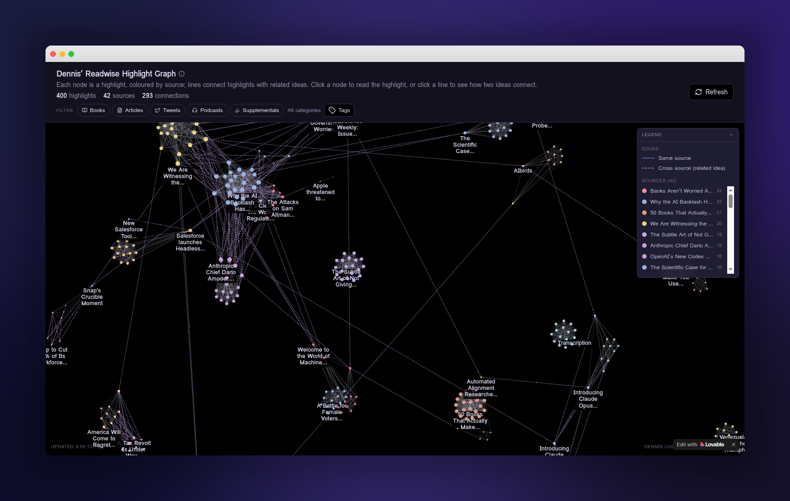

# Reader Rhizome

An interactive force-directed graph that surfaces hidden connections across your Readwise highlights. Each book is a cluster, each highlight a node, and dotted edges link semantically related ideas across sources — turning your reading history into a living web of thought.

🌐 **Live:** [highlights.chiuten.co](https://highlights.chiuten.co) · [reader-rhizome.lovable.app](https://reader-rhizome.lovable.app)



## What it does

- **Pulls highlights from Readwise** via an edge function and caches them locally.
- **Embeds each highlight** with an AI model and stores vectors in the backend (with a localStorage cache for fast reloads).
- **Computes cross-source connections** using cosine similarity above a configurable semantic threshold (currently `0.4`).
- **Visualizes the rhizome** as a 2D force graph: same-book highlights cluster together, dotted edges with traveling particles mark cross-book connections.
- **Summarizes connections** on demand via an AI edge function — explaining *why* two ideas relate.
- **Filters by category, tag, and source** with an interactive legend.

## Stack

- **Frontend:** React 18 + Vite + TypeScript + Tailwind + shadcn/ui
- **Graph:** `react-force-graph-2d` with custom canvas rendering
- **Backend:** Lovable Cloud (Supabase) — Postgres with pgvector, edge functions
- **AI:** Lovable AI Gateway (Gemini for embeddings + summaries)
- **Source:** Readwise API

## Architecture

```
src/
├── components/
│   ├── HighlightGraph.tsx      # thin orchestrator
│   └── graph/                  # focused graph modules
│       ├── buildGraphData.ts   # nodes/links/neighbors construction
│       ├── drawNode.ts         # canvas node + label rendering
│       ├── useGraphFocus.ts    # d3-force tuning + auto-fit zoom
│       ├── useGraphWheelPan.ts # trackpad pan handling
│       └── LinkTooltip.tsx     # hovered-edge tooltip
├── hooks/
│   ├── useReadwiseData.ts      # fetch + embed + connection pipeline
│   └── useConnectionSummary.ts # on-demand AI summaries
├── lib/
│   ├── connections.ts          # cosine similarity edge selection
│   ├── embeddings.ts           # vector cache + batching
│   └── readwise.ts             # API client
└── pages/Index.tsx             # main view

supabase/functions/
├── readwise-fetch/             # proxy Readwise API
├── embed-highlights/           # batch embeddings
└── summarize-connection/       # AI explanation of a pair
```

## Key knobs

Located in `src/hooks/useReadwiseData.ts`:

- `semanticThreshold` (`0.4`) — minimum cosine similarity for a cross-source edge
- `semanticMaxEdges` — global cap on connection count
- `semanticPerNode` — per-node fan-out cap

The graph also supports a `simplified` mode with a `maxNodes` cap for small viewports — see `src/pages/Index.tsx`.

## Development

```sh
npm install
npm run dev
```

Backend (Lovable Cloud) is auto-provisioned. Edge functions deploy automatically on save. Add a `READWISE_TOKEN` secret in Lovable Cloud settings to enable highlight fetching.

## Editing

- **In Lovable:** [open the project](https://lovable.dev/projects/d0793b9f-7ac7-48ce-967a-2c01edce7ed8) and prompt.
- **Locally:** clone, edit, push — changes sync both ways.
